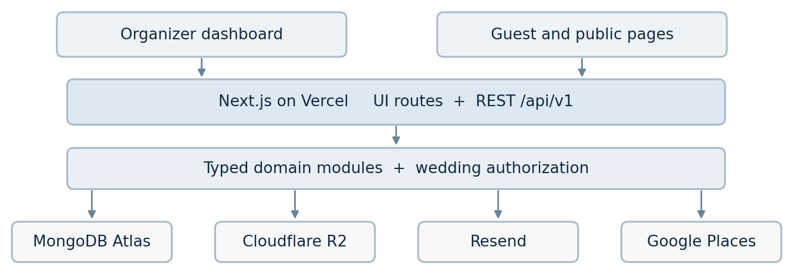

# Make My Marriage System Design Architecture

> Converted from the [original Word document](source/system-design.docx). Wording and provisional decisions are preserved; approved implementation decisions are tracked in [architecture-decisions.md](architecture-decisions.md).

Version 1.0 | October 2026 | Engineering design baseline

A wedding-centered modular monolith for collaborative Indian wedding planning, public wedding pages, invitation workflows, and private guest media. The design below fixes the deployment and data boundaries and provides an implementation contract for V1.

## Design decision

Use one TypeScript Next.js deployment on Vercel. The Node.js REST layer owns all business writes and enforces wedding-scoped authorization. MongoDB Atlas with Mongoose stores transactional application state; Cloudflare R2 stores images; Resend handles outgoing email; Google Places supplies vendor search. No separate API server, message broker, or dedicated worker service is required for V1.

| Concern      | Decision                                                                                   |
| ------------ | ------------------------------------------------------------------------------------------ |
| Application  | Next.js App Router and Node.js route handlers in one repository                            |
| Persistence  | MongoDB Atlas with Mongoose; one database and weddingId-scoped records                     |
| Identity     | Custom password login and database-backed sessions; no mandatory signup email verification |
| Guest access | Login-free, high-entropy invitation and gallery bearer tokens                              |
| Media        | Private Cloudflare R2 bucket with browser-to-R2 uploads using presigned URLs               |
| Email        | Resend and MongoDB-backed delivery records processed in small batches                      |
| Runtime      | Vercel deployment; authenticated scheduled route for due reminders                         |

## Scope and boundaries

V1 includes wedding setup, multi-function events, organizer membership, tasks, expense records, guests and per-event invitations, RSVP collection, nearby vendor discovery and saved vendors, a simple themed wedding website, YouTube livestream embedding, and a private wedding photo gallery. Guests can view or upload photos and respond to invitations without accounts.

Explicit non-goals. No per-event budget allocation, no individual accounts for accompanying family members, no guest login, no automated WhatsApp/SMS delivery, no payment processing, no custom livestream infrastructure, no public photo bucket, no microservices, and no external application monitoring service.

Tenant invariant. Every organizer belongs to at most one wedding in V1. Each wedding can have multiple organizers. Wedding-owned data never crosses wedding boundaries, including data accessed through guessable IDs or guest tokens.

## 1 Logical architecture

The Next.js process exposes UI routes and versioned REST endpoints, but the modules behind those endpoints remain independent of framework request objects. Organizer sessions and scoped guest tokens enter through different authorization paths.



MongoDB Atlas is accessed through Mongoose. R2 uploads and downloads use temporary presigned URLs; Resend and Google Places are called from server modules. YouTube playback is embedded in the public wedding pages and does not pass through our backend.

## 2 Runtime and module structure

### 2.1 Source organization

```text
src/app/(dashboard)/...              organizer UI
src/app/(public)/w/[slug]/...        public wedding site
src/app/(guest)/...                  RSVP and gallery UI
src/app/api/v1/.../route.ts          versioned REST adapters
src/modules/{auth,weddings,events,tasks,expenses}/...
src/modules/{members,guests,invitations,rsvps}/...
src/modules/{vendors,website,photos,email}/...
src/lib/db.ts                       cached Atlas connection
src/lib/{security,errors,logging}.ts shared infrastructure
```

A route handler parses input, validates it, authenticates the caller, delegates to a service, and maps the result to HTTP. Services own permissions and domain invariants. Repositories contain Mongoose queries. Every internal module must remain callable without an HTTP request to support tests and the email processor.

- Use Node.js runtime for MongoDB, password hashing, and R2/Resend SDK work. Never import server modules into client components.

- Use Zod or an equivalent typed validator at API boundaries; generate request and response types from the same schemas where practical.

- Require all frontend business writes to use the REST layer. The frontend and backend share TypeScript DTOs but not database models.

- Cache the Mongoose connection per warm function instance, set timeouts and pool sizing intentionally, and avoid per-request new connections.

### 2.2 Deployment topology

Deploy one Next.js application to Vercel. Serverless Node.js functions connect to MongoDB Atlas, R2, Resend, and Google Places over TLS. Static assets and public pages can use normal Next.js caching, but authenticated, token-scoped, and guest-private content must not enter public caches. Scheduled email processing uses a protected Vercel Cron endpoint.

Commercial hosting. Vercel Hobby is restricted to non-commercial use. Select Pro or another eligible commercial plan before launching this as a commercial product. Vercel functions are request-bound; do not rely on an in-process scheduler, global memory, or a permanent worker.

## 3 Wedding tenancy and organizer identity

### 3.1 Membership model

The User document contains a nullable weddingId and role rather than a general many-to-many organization membership collection. On signup, both are null. Wedding creation assigns the creator the Admin role. An existing user may join through a valid member invitation only when they have no wedding. This gives the one-user-one-wedding rule a direct database representation.

| Actor         | Identity                              | Authorization                                                |
| ------------- | ------------------------------------- | ------------------------------------------------------------ |
| Admin         | Organizer account plus session        | All planner features and organizer membership management     |
| Manager       | Organizer account plus session        | All planner features except membership management            |
| Guest         | Guest contact and scoped bearer token | RSVP for invited functions; scoped gallery view/upload       |
| Public viewer | No identity                           | Published wedding homepage and published event schedule only |

Each non-public query derives its effective weddingId from the authenticated session or validated token. Client-supplied weddingId is never sufficient evidence of access. The service verifies ownership on reads, writes, nested references, download URLs, and membership changes.

### 3.2 Session authentication

1.  POST signup with normalized unique email and password. Validate email syntax but do not send or require verification.

2.  Hash passwords using Argon2id with parameters appropriate to the deployed runtime. Never store reversible credentials.

3.  POST login creates a cryptographically random, opaque session token; only its hash is stored in MongoDB with userId, expiry, and revocation metadata.

4.  Send the token only as a Secure, HttpOnly, SameSite cookie. Rotate sessions on sensitive events and revoke them on logout or password reset.

5.  Validate the session and role on protected endpoints; add CSRF protection or strict Origin checks for cookie-authenticated mutations.

Proposed session policy: 7-day idle timeout and 30-day absolute lifetime, configurable. Login, signup, password reset, member invitations, and guest links have rate limits backed by shared state rather than function memory.

### 3.3 Organizer invitations

An Admin invites a named email to the wedding. The system stores only a hash of the random invite secret, together with weddingId, target email, intended role, expiry, and consumption state. Acceptance requires the token and an organizer account with the matching normalized email. The token proves possession of the invited link, not ownership of the mailbox. Consume the token atomically while attaching the user to the wedding; no separate verification email is sent.

Conflict handling. Reject reuse, revocation, expired tokens, mismatch between account email and invite, and users already associated with another wedding. A member cannot remove or demote the last active Admin. The exact privilege for inviting the second Admin is listed under open configuration decisions.

Unverified email risk. A third party may pre-register another person's email. Account recovery must allow the mailbox holder to regain control using a secure password reset link; the invitation token itself must never allow account takeover. Display email delivery status without claiming that an unverified address is owned by the registrant.

## 4 Data model

Use separate collections for independently growing aggregates. Each wedding-owned collection carries weddingId and createdAt/updatedAt. IDs use ObjectId internally; external routes validate IDs before querying. Mongoose schemas enforce shape, and API/service validation enforces cross-document rules.

| Collection      | Important fields                                               | Notes                                                         |
| --------------- | -------------------------------------------------------------- | ------------------------------------------------------------- |
| users           | emailNormalized, passwordHash, weddingId?, role?, status       | Globally unique normalized email; one wedding per user        |
| sessions        | tokenHash, userId, expiresAt, revokedAt                        | TTL on expiration; no raw tokens                              |
| weddings        | slug, displayNames, timezone, location, websiteTheme, liveUrl  | Tenant root; public display content separated                 |
| memberInvites   | weddingId, email, role, tokenHash, expiresAt, consumedAt       | Short-lived single-use join capability                        |
| events          | weddingId, name, startsAt, endsAt, venue, publish              | Independent functions; public schedule filters                |
| tasks           | weddingId, eventId?, assigneeUserId?, status, dueAt            | Assignment must belong to same wedding                        |
| expenses        | weddingId, eventId?, vendorId?, amountMinor, currency, paidAt  | Actual expense ledger; no budget projections                  |
| vendors         | weddingId, placeId?, name, category, contact, notes            | Saved vendor snapshot; Places search is transient             |
| guestContacts   | weddingId, name, emailNormalized, phone?                       | One recipient can represent a family                          |
| invitations     | weddingId, eventId, guestContactId, tokenHash, rsvp            | One guest invitation per event; plus guests stored as a count |
| galleryTokens   | weddingId, guestContactId, tokenHash, expiresAt, revokedAt     | Guest-specific QR/link, distinct from per-event RSVP token    |
| photos          | weddingId, eventId?, objectKey, mime, bytes, state, uploadedBy | R2 metadata and moderation/removal state                      |
| emailDeliveries | weddingId, type, targetId, status, leaseUntil, nextAttemptAt   | Durable pending work and per-message send result              |
| emailBatches    | idempotencyKey, deliveryIds, providerState, createdAt          | Stable retry identity and batch audit                         |

### 4.1 Location representation

Store venue name, structured address, city/state/country/postal code, and a GeoJSON Point. GeoJSON coordinates follow [longitude, latitude] order, while API DTOs may expose explicit latitude and longitude fields. Validate latitude -90 to 90 and longitude -180 to 180. Weddings provide a default location, overridden by each event when needed.

```json
"location": {
  "venue": "Example Banquet Hall",
  "address": {"city": "Jaipur", "country": "India"},
  "geo": {"type": "Point", "coordinates": [75.78, 26.91]},
  "googlePlaceId": "optional"
}
```

### 4.2 Constraints and indexes

- users: unique index on emailNormalized; weddingId and role secondary indexes for member listing.

- weddings: unique index on slug; immutable tenant ID for internal references.

- invitations: unique compound (weddingId, eventId, guestContactId), plus unique tokenHash; allow token rotation without duplicate invitations.

- guestContacts: (weddingId, emailNormalized) indexed; confirm whether shared email among multiple family representatives is permitted before making unique.

- tasks, expenses, events, photos, and vendors: weddingId-first compound indexes matching common filters and sort keys.

- emailDeliveries: compound (status, nextAttemptAt, leaseUntil); unique logical notification key to suppress duplicate reminders.

- sessions and expiring invitation tokens: TTL indexes as cleanup, never as the only expiry check in authorization.

Use MongoDB transactions only for multi-document invariants such as consuming a member invitation while assigning wedding membership, or creating invitations alongside delivery records. Use unique indexes and compare-and-set updates for routine concurrency; avoid transactions around external Resend or R2 calls.

## 5 REST API contract

### 5.1 Conventions

- Prefix all endpoints with /api/v1. Use resource nouns, standard HTTP methods, and JSON payloads except binary transfers directly to R2.

- Organizer endpoints use session cookies; guest endpoints use scoped tokens or a short-lived guest capability cookie obtained from a unique link.

- Use GET for reads, POST for create/actions, PATCH for partial updates, PUT for idempotent RSVP state replacement, DELETE for revocation/removal.

- Paginate lists with stable cursor or page+limit; cap server-side page size. Reject unknown, malformed, or unauthorized nested IDs.

- Set no-store on authenticated and guest-private API responses. Only explicitly published website content can be cached publicly.

### 5.2 Organizer endpoints

| Method and route                                 | Purpose                                  | Access            |
| ------------------------------------------------ | ---------------------------------------- | ----------------- |
| POST /auth/signup; /auth/login; /auth/logout     | Account/session lifecycle                | Public / session  |
| POST /auth/forgot-password; /auth/reset-password | Secure recovery email flow               | Public with token |
| POST /weddings; GET /weddings/me                 | Create or fetch tenant                   | Signed-in user    |
| PATCH /weddings/:id                              | Wedding profile, location, theme, stream | Admin or Manager  |
| GET /weddings/:id/members                        | Member directory                         | Admin or Manager  |
| POST /weddings/:id/member-invites                | Invite organizer                         | Admin             |
| POST /member-invites/accept                      | Join wedding by token                    | Signed-in invitee |
| PATCH /weddings/:id/members/:userId              | Manager role/status management           | Admin             |
| GET, POST /weddings/:id/events                   | List and create functions                | Admin or Manager  |
| PATCH, DELETE /weddings/:id/events/:eventId      | Edit or archive event                    | Admin or Manager  |
| GET, POST /weddings/:id/tasks                    | Task collection                          | Admin or Manager  |
| PATCH, DELETE /weddings/:id/tasks/:taskId        | Change task state                        | Admin or Manager  |
| GET, POST /weddings/:id/expenses                 | Expense entries and totals               | Admin or Manager  |
| PATCH, DELETE /weddings/:id/expenses/:expenseId  | Correct expense entry                    | Admin or Manager  |
| GET, POST /weddings/:id/guests                   | Guest contact directory                  | Admin or Manager  |
| POST /weddings/:id/events/:eventId/invitations   | Create per-event invites                 | Admin or Manager  |
| POST /weddings/:id/emails/send                   | Queue selected invitation emails         | Admin or Manager  |
| GET /weddings/:id/emails                         | Review send statuses/errors              | Admin or Manager  |

### 5.3 Vendors website and media endpoints

| Method and route                                            | Purpose                                  | Access               |
| ----------------------------------------------------------- | ---------------------------------------- | -------------------- |
| GET /weddings/:id/vendors/discover                          | Google Places nearby search              | Admin or Manager     |
| GET, POST /weddings/:id/vendors                             | Saved vendor collection                  | Admin or Manager     |
| PATCH, DELETE /weddings/:id/vendors/:vendorId               | Maintain saved vendor                    | Admin or Manager     |
| PATCH /weddings/:id/website                                 | Theme, published content, live URL       | Admin or Manager     |
| POST /weddings/:id/photos/upload-intents                    | Create scoped R2 PUT URL                 | Admin or Manager     |
| POST /weddings/:id/photos/:photoId/complete                 | Verify uploaded object                   | Admin or Manager     |
| GET /weddings/:id/photos                                    | Private organizer gallery listing        | Admin or Manager     |
| DELETE /weddings/:id/photos/:photoId                        | Remove gallery photo                     | Admin or Manager     |
| GET /public/weddings/:slug                                  | Published homepage and schedule          | Public               |
| POST /guest/access/exchange                                 | Exchange QR/link token for scoped cookie | Bearer token         |
| GET /guest/invitations/:id; PUT /guest/invitations/:id/rsvp | Read invitation and update RSVP          | Invitation scope     |
| GET /guest/gallery/photos                                   | List authorized gallery entries          | Gallery scope        |
| POST /guest/gallery/upload-intents                          | Create guest upload URL                  | Gallery upload scope |
| POST /guest/gallery/photos/:id/complete                     | Complete authorized upload               | Gallery upload scope |

### 5.4 Response and error semantics

Return a stable envelope and machine-readable error code. A 202 response to email send requests means accepted for processing, not delivered. A 201 response to an upload-intent request means metadata is staged, not that a file exists in R2.

```http
HTTP/1.1 409 Conflict
{"error": {
  "code": "ALREADY_MEMBER_OF_WEDDING",
  "message": "This account already belongs to a wedding",
  "requestId": "req_..."
}}
```

| Status    | When to use                                                                        |
| --------- | ---------------------------------------------------------------------------------- |
| 400 / 422 | Malformed request / syntactically valid but domain-invalid data                    |
| 401 / 403 | Unauthenticated or invalid token / authenticated but not authorized                |
| 404       | Unknown resource, including cross-tenant resources where hiding existence is safer |
| 409       | Concurrent update, duplicate invite, wedding membership or uniqueness conflict     |
| 413 / 415 | Photo exceeds permitted size / unsupported file type                               |
| 429       | Rate or quota exceeded; return Retry-After where appropriate                       |
| 502 / 503 | External provider failure or transient service unavailability                      |

## 6 Critical request flows

### 6.1 Signup and first wedding

1.  Validate email format/password, enforce unique normalized email, hash password, insert user with weddingId null, and create session.

2.  Create wedding with unique slug and timezone; atomically associate user with the wedding as first Admin.

3.  If a create request is retried, prevent an unintended second wedding using a client idempotency key or a user-level create state and compare-and-set update.

4.  A second organizer joins through a separate invitation token; guest contact records do not become organizer accounts.

### 6.2 Per-event RSVP

1.  Organizer creates guest contact and one invitation for each event they want the family to attend.

2.  Invitation email contains a guest-specific URL. A secret token is hashed at rest and scoped to the target invitation and wedding.

3.  Guest opens link; API validates capability and returns only the relevant event details and RSVP state.

4.  Guest selects attending or declined and a nonnegative integer count of additional guests. No application-level plus-one limit or couple approval is imposed.

5.  PUT updates one RSVP atomically and records respondedAt. Repeat identical submissions are idempotent; the latest accepted edit wins.

Invitation validity, RSVP edit cutoff, and token revocation are separate controls. An expired or revoked token cannot reveal RSVP details. Public event schedule visibility never grants invitation or RSVP permissions.

### 6.3 Private photo upload and viewing

1.  An organizer session or guest gallery capability requests an upload intent with file name, expected type, and size.

2.  Server creates a pending photo record with an unguessable R2 object key and returns a short-lived presigned PUT URL. The bucket remains private.

3.  Browser uploads directly to R2, avoiding Vercel request-body limits and unnecessary bandwidth through the app.

4.  Client calls the completion API. Server verifies object existence, type and observed size through R2 metadata before marking photo ready.

5.  Gallery list returns authorized photo metadata and short-lived presigned GET URLs. Guest links remain scoped and revocable.

Restrict allowed image formats, reject oversized objects, rate-limit upload intents, and run periodic cleanup for abandoned pending records and orphan objects. Signed URLs are temporary bearer credentials. Do not put them in public logs, analytics, or cached pages. Consider generating privacy-preserving thumbnails and stripping EXIF metadata in a later enhancement; V1 must avoid unnecessarily exposing location metadata.

### 6.4 Private gallery QR tokens

Because invitations are per event but the gallery spans the wedding, keep two capability types. Invitation tokens are scoped to a specific guest-event pair and its RSVP. Gallery tokens are scoped to the guest contact and wedding; the QR code embeds the guest's gallery link. A gallery token can be used more than once until it expires or is revoked, which makes printed QR codes practical.

The first request may exchange the URL token for a short-lived guest capability cookie and remove the raw secret from browser history. Links remain transferable: without guest login we cannot prove the person holding a QR code is the intended recipient. Enforce rate limits and explicit revocation to limit abuse.

## 7 Lightweight email processing

### 7.1 Durable work records

Creating an invitation or scheduling a reminder records an emailDelivery item in MongoDB. The send API returns 202 once that durable record exists. A manual send action can trigger one small batch immediately; a scheduled Vercel route also processes pending and due items. This is a queue pattern implemented with MongoDB documents, not a separate queue service.

| State     | Meaning                                         | Transition                        |
| --------- | ----------------------------------------------- | --------------------------------- |
| pending   | Accepted, awaiting its next attempt             | Eligible after nextAttemptAt      |
| leased    | Worker claimed item with a leaseUntil timestamp | Provider call or lease recovery   |
| submitted | Resend accepted the request; provider ID saved  | Terminal for V1 sending dashboard |
| retry     | Transient failure; exponential backoff          | Re-enqueue after nextAttemptAt    |
| failed    | Permanent error or retries exhausted            | Visible manual resolution         |

### 7.2 Batch algorithm

1.  Select due pending/retry records and atomically lease up to 25-50 at a time. Leases expire if the function stops unexpectedly.

2.  Group records into a stable Resend batch payload; store the batch ID and idempotency key before the provider call.

3.  Send the batch once; persist provider message IDs and per-delivery submission results where available.

4.  On retryable errors, use bounded exponential backoff and retain the same logical idempotency key for identical requests.

5.  On ambiguous outcomes, reconcile using stored provider identifiers/idempotency support. Never blindly duplicate an email after a timeout.

Resend currently supports up to 100 email messages in a batch API request. A smaller default improves failure isolation and works within Vercel's request-bound execution model. Respect provider account-level rate and daily quotas across every wedding; the free tier currently limits daily sends, so bulk delivery may be delayed or require an upgrade.

Reminders. Store dueAt in UTC with the wedding's IANA timezone as configuration. Schedule reminders against event-relative rules, deduplicate by a unique key such as (invitationId, reminderType, scheduledFor), and use a secret-protected Vercel Cron route. Cron can run twice or late, so leases and idempotency are mandatory.

## 8 Security and privacy

| Risk                     | Required control                                                                                 |
| ------------------------ | ------------------------------------------------------------------------------------------------ |
| Cross-wedding access     | Derive weddingId from session/token; compound-scoped queries; negative authorization tests       |
| Credential attacks       | Argon2id, rate limits, password reset tokens, session revocation, cookie and CSRF controls       |
| Guest link forwarding    | Random high-entropy scoped tokens, hash at rest, expiry, rotation and revoke controls            |
| Token disclosure         | Redact route secrets; no third-party scripts on token landing pages; Referrer-Policy no-referrer |
| Private photos           | R2 private bucket, signed read/write, per-wedding keys, upload verification and object deletion  |
| Upload abuse             | Strict MIME/type checks, size and count limits, server validation and manual removal controls    |
| External HTML and embeds | Sanitize wedding content; validate allowed YouTube host/video IDs; avoid arbitrary iframe URLs   |
| PII and logs             | Never log passwords, session keys, guest tokens, signed URLs or full guest records               |
| API misuse               | Schema validation, rate limits, pagination caps, per-tenant resource quotas                      |

Use environment-scoped secrets in Vercel, rotate API keys after compromise, and enable Atlas authentication, encrypted TLS connections, least-privilege users, backups, and appropriate network controls. Do not expose Google Places server keys, Resend keys, MongoDB URIs, or R2 credentials in the client bundle.

Expense records are shared across all organizer accounts of a wedding but never visible on its public website. Published schedule data and private guest records require separate serialization paths; a broad wedding document must not be returned directly to public routes.

## 9 Reliability performance and operations

### 9.1 Failure and consistency model

- Database is the system of record. External API requests are fallible and must not occur inside long MongoDB transactions.

- Use stable IDs and logical idempotency keys on wedding creation, invitation sends, photo completion, and reminder creation.

- Show partial failures explicitly. 'Submitted to Resend' does not mean the message reached an inbox; without webhooks delivery confirmation is out of V1 scope.

- Treat Google Places as optional: discovery failures must not break manual vendor entry or wedding planning.

- A failed R2 upload leaves a pending record that expires; a failed metadata write after upload is reconciled by completion retry and orphan cleanup.

- Use optimistic concurrency on frequently edited records if conflicting organizer edits become common; otherwise last-write-wins with updatedAt awareness is acceptable for V1.

### 9.2 Performance budget and scaling

The monolith is stateless between requests and scales through Vercel function concurrency, while MongoDB Atlas handles primary database capacity. Key risks are bursty RSVP traffic, wedding-day photo viewing, and large multi-wedding email campaigns. Start with cursor-paginated lists, compound indexes, thumbnails when needed, and short R2 GET URLs; avoid loading all guests or photos into memory. Revisit the background worker design only if throughput and reliability data justify it.

Cost management. Monitor Atlas storage/connections, R2 stored GB and operations, Resend usage, Google Places usage, and Vercel function execution. Cloudflare R2 has a Standard free tier, but multi-wedding galleries can exceed it. Vendor discovery should request only needed Places fields and cache safe search results briefly.

### 9.3 Logging and backups

Use structured JSON application logs through console output in Vercel. Each entry records timestamp, requestId, route template, operation, duration, status, and redacted error code. Do not add Sentry, Datadog, or other external monitoring products in V1. Ensure Vercel's log retention matches incident-debugging needs; otherwise document its limitations.

Enable Atlas backup capabilities appropriate to the selected cluster tier, define retention and restore procedures, and test restoration in staging. Deleting a wedding requires a deliberate multi-stage process for dependent records, R2 objects, guest capabilities, and pending emails rather than an unchecked cascading delete.

## 10 Testing and release controls

| Test level           | Minimum coverage                                                                                     |
| -------------------- | ---------------------------------------------------------------------------------------------------- |
| Unit                 | Service invariants, role checks, RSVP count, amountMinor math, reminder scheduling, token expiry     |
| API integration      | Routes, Mongoose models, indexes, error envelopes, race conditions, cross-tenant isolation           |
| Provider integration | Resend transient failure, R2 signed upload lifecycle, Google Places timeout and quota errors         |
| End to end           | Signup, wedding create/join, per-event invite, RSVP, guest upload, gallery private access            |
| Security regression  | Brute force throttling, CSRF, forwarded/revoked links, leaked resource IDs, forbidden member changes |
| Operations           | Duplicate Cron calls, expired leases, provider ambiguous result, backup restore, rollback            |

Implement a test matrix for empty/malformed requests, duplicate action submission, concurrent updates, deleted events and guests, users without a wedding, expired member and guest tokens, negative or non-integer plus-guest counts, unavailable Atlas, failed uploads, and partial provider success. 'All corner cases' is an ongoing engineering objective, not a finite guarantee; a release gate requires the known high-risk paths to be explicitly tested.

## 11 Deployment and configuration

### 11.1 Environments

Maintain local, staging, and production configurations with isolated MongoDB databases, R2 buckets or key prefixes, Resend sender domains or test modes, and Google Places keys. Use migrations as versioned scripts for schema/index creation. Run CI checks for typing, linting, tests, and a production build before Vercel promotion. Keep the previous deployment available for rollback.

| Configuration                                         | Purpose                                                     |
| ----------------------------------------------------- | ----------------------------------------------------------- |
| MONGODB_URI                                           | Atlas connection string, server only                        |
| SESSION_SECRET                                        | Cryptographic material for session/token-related operations |
| R2_ACCOUNT_ID, R2_ACCESS_KEY_ID, R2_SECRET_ACCESS_KEY | Presigned URL creation, server only                         |
| R2_BUCKET                                             | Target private photo bucket                                 |
| RESEND_API_KEY, RESEND_FROM_EMAIL                     | Transactional and bulk sender                               |
| GOOGLE_PLACES_API_KEY                                 | Vendor search, server side                                  |
| CRON_SECRET                                           | Protect scheduled email processing endpoint                 |
| APP_BASE_URL                                          | Canonical URLs for invitation and gallery links             |

### 11.2 Initial delivery sequence

1.  Foundation: repo structure, typed validation, Atlas integration, errors and logs, login/session layer, wedding creation and member invitation.

2.  Planning core: events, tasks, expense tracking, vendor search and saved vendors, wedding website publishing.

3.  Guest workflows: contacts, per-event invites and RSVP, email work records, Resend batching and reminder Cron.

4.  Media: private R2 integration, upload intents, photo verification, private guest-specific gallery and QR links.

5.  Hardening: test matrix, backups, rate limits, tenant isolation review, performance checks, production rollout.

## 12 Open configuration decisions

The architecture above follows the agreed stack. These smaller choices are proposed defaults to settle during API and UX specification, rather than commitments already made by the product team.

| Decision                   | Suggested V1 default                                                                                 | Consequence if changed                                       |
| -------------------------- | ---------------------------------------------------------------------------------------------------- | ------------------------------------------------------------ |
| Second Admin onboarding    | Creator is Admin; an Admin may invite one or more additional Admins, but only Admins edit membership | Admin invitation privilege must be explicit in access checks |
| RSVP edit cutoff           | Allow edits until the relevant event starts                                                          | Changes token validity and reminder/attendance semantics     |
| Invitation token lifecycle | Revocable invitation; per-event RSVP token remains reusable until cutoff                             | Single-use invitation URLs would block later RSVP edits      |
| Gallery token lifecycle    | One revocable QR per guest contact, limited to one wedding                                           | May add event-specific photo permissions later               |
| Gallery upload policy      | Guest uploads allowed; organizers can remove photos; no preapproval                                  | Moderation workflow adds new states and UI                   |
| Image constraints          | Accept JPEG, PNG, WebP, HEIC only after verified decoding; choose max size before build              | Changes upload validation and thumbnail processing           |
| Account sessions           | 7-day idle and 30-day absolute expiration                                                            | Affects convenience and account security                     |
| Website addressing         | Path under platform domain such as /w/:slug                                                          | Custom domains need DNS and certificate workflow             |
| Wedding deletion           | Confirm with Admin; soft-delete first                                                                | Retention and R2 cleanup remain to be set                    |

## 13 Architecture acceptance checklist

- Every protected REST endpoint enforces session identity, role, wedding ownership, and schema validation.

- A guest cannot access another guest's RSVP or a gallery from another wedding using IDs alone.

- Private photos never require a publicly readable R2 bucket or permanent unscoped URLs.

- Email batching can safely restart after timeout, duplicate Cron invocation, and provider retries.

- An organizer cannot join multiple weddings, and the last active Admin cannot be removed.

- Organizer-visible expense totals are based on integer monetary units and remain private to the wedding.

- The deployment is commercially eligible, backup and restoration are tested, and V1 has error-handling coverage for critical paths.

## Source documentation

These official references support the selected platform mechanisms. Pricing, limits, and framework behavior should be reconfirmed when the implementation starts.

https://nextjs.org/docs/app/getting-started/route-handlers

https://mongoosejs.com/docs/transactions.html

https://www.mongodb.com/docs/atlas/

https://developers.cloudflare.com/r2/pricing/

https://developers.cloudflare.com/r2/api/s3/presigned-urls/

https://resend.com/docs/api-reference/emails/send-batch-emails

https://resend.com/pricing

https://vercel.com/docs/cron-jobs

https://vercel.com/docs/limits/fair-use-guidelines

https://developers.google.com/maps/documentation/places/web-service/nearby-search

https://cheatsheetseries.owasp.org/cheatsheets/Password_Storage_Cheat_Sheet.html
